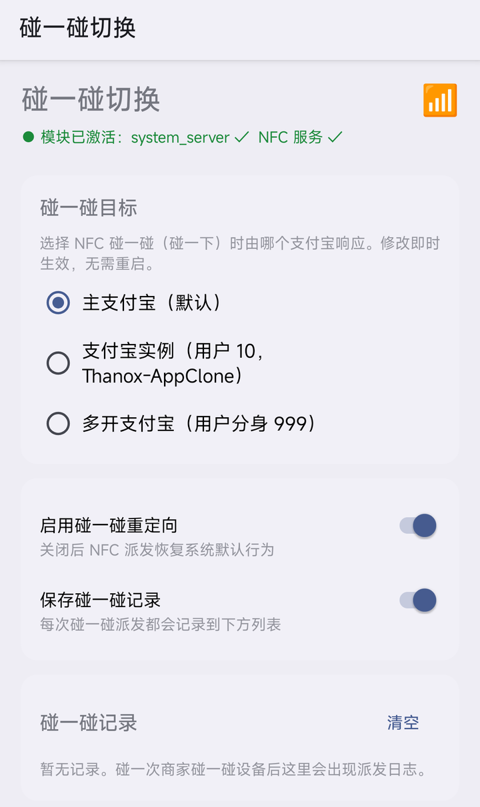
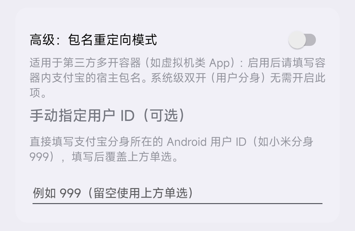

# 支付宝碰一碰切换

支付宝碰一碰切换（AlipayNfcSwitch）是一个 LSPosed 模块。手机识别到支付宝的 NFC 标签后，模块按设置把打开请求交给主支付宝、小米应用分身中的支付宝，或能接收该请求的第三方多开容器。

[下载 APK](https://github.com/Android-Modules/Alipay-Tap-to-Pay/releases/latest) · [查看 Actions 构建](https://github.com/Android-Modules/Alipay-Tap-to-Pay/actions/workflows/build-apk.yml)

## 实机界面

以下截图取自小米 13 Ultra（HyperOS 3、Android 16）上的 v1.0.7。第一张显示注入状态、支付宝实例和记录开关，第二张显示包名模式和手动用户 ID。

<p>
  
  
</p>

## 安装与启用

需要已安装并正常运行的 LSPosed、支持 NFC 的安卓手机，以及至少一个已安装的支付宝实例。

1. 从 [GitHub Releases](https://github.com/Android-Modules/Alipay-Tap-to-Pay/releases) 下载并安装 APK。
2. 打开 LSPosed 管理器，在「模块」中启用「碰一碰切换」。
3. 在作用域中勾选 **Android 系统**（`android`）和 **NFC**（`com.android.nfc`）。
4. 重启手机、解锁并开启 NFC。打开「碰一碰切换」，确认顶部的 `system_server` 和「NFC 服务」都打勾。升级模块后也需要重启，以便系统进程加载新版本。

## 选择碰一碰目标

| 场景 | 设置方法 |
| --- | --- |
| 主支付宝 | 在「碰一碰目标」选择「主支付宝（默认）」，并关闭包名模式、留空手动用户 ID。 |
| 小米应用分身 | 在同一列表选择「多开支付宝（用户分身 999）」。系统框架会扫描各 Android 用户中已安装的支付宝。 |
| 其他 Android 用户或分身 | 优先选择自动扫描出的实例。知道准确用户 ID 时，可在高级设置中手动填写。手动输入会覆盖上方选择。 |
| 第三方多开容器 | 打开「包名重定向模式」并填写宿主包名。容器需要能接收并转发支付宝的 NFC 打开请求。 |

模块注入后，切换目标或开关无需重启。关闭「启用碰一碰重定向」会恢复系统默认派发。打开「保存碰一碰记录」可查看最近 30 条派发的时间和去向，记录中可能包含链接。要清除已有记录，可点列表旁的「清空」。

## HyperOS 兼容情况

| 环境 | 已验证内容 |
| --- | --- |
| Redmi K90 · HyperOS 3 · Android 16 · LSPosed 2.1.1 | 开发与 NFC 派发链路验证。 |
| 小米 13 Ultra · HyperOS 3 · Android 16 | v1.0.7 安装与界面，主支付宝和多个实例可见。 |
| Redmi K70 · HyperOS 4 · Android 17 · LSPosed 2.2.1 | 重启后确认两个作用域已注入。验证了主支付宝、分身和包名模式的转发逻辑，以及启动失败时的回退。 |

HyperOS 4 上碰到网页类标签后，系统可能先显示「打开链接」通知。点通知里的「打开」后，NFC 界面才会继续转发。商家设备的实机支付流程待验证。 [Android NFC 派发说明](https://developer.android.com/develop/connectivity/nfc/nfc)

## 用普通 NFC 标签测试拉起支付宝

没有商家设备时，可用一张可写的 NDEF 标签测试手机是否识别标签，以及系统是否能拉起支付宝。

1. 用 NFC 写卡工具添加 URL 记录，填入支付宝服务协议及隐私权政策页的链接 `https://render.alipay.com/p/c/17qjvbnlkcw0`。 [支付宝官方页面](https://render.alipay.com/p/c/17qjvbnlkcw0)
2. 若写卡工具支持 Android Application Record（AAR），可在 URL 后添加一条应用记录，包名填 `com.eg.android.AlipayGphone`。AAR 可帮助系统选中支付宝，实际行为取决于 ROM。 [Android AAR 说明](https://developer.android.com/develop/connectivity/nfc/nfc#aar)
3. 写入后退出写卡工具。模块中选择「主支付宝（默认）」，确认手机已解锁并开启 NFC，再用手机背面贴近标签。如果出现「打开链接」通知，点「打开」。
4. 观察前台是否出现主支付宝或它的登录页，再检查模块记录。此测试覆盖读卡、链接派发和应用启动。

## 排查

| 现象 | 检查方法 |
| --- | --- |
| 顶部提示未检测到注入 | 检查 LSPosed 中两个作用域是否都已勾选，重启后再看状态。 |
| 只显示 `system_server` 已激活 | 解锁手机，确认 NFC 已开启，再打开模块检查 NFC 服务状态。 |
| 没有列出分身 | 确认支付宝已安装在对应分身内，然后点「重新扫描支付宝实例」。 |
| 能读到标签，支付宝未打开 | 检查是否有待确认的系统通知。若日志显示 `ndefMsg=null`，用写卡工具回读标签，确认能读到 URL 记录。 |
| 已拉起分身，商家流程无法继续 | 在目标分身内检查支付宝的登录和碰一碰开通状态。 |

在电脑上可读取 NFC 和模块日志。

```bash
adb logcat -d -s AlipayNfc NfcService NfcDispatcher
```

HyperOS 4 上的 `dispatch hook installed on NFC activity forwarding` 表示转发钩子已安装。派发日志中，`-> user 0 (default)` 对应主支付宝，`-> user 999` 对应小米应用分身，`system default (redirect failed)` 表示启动重定向目标失败后走了原始派发。

## 实现与构建

- `NfcHook` 处理支付宝的标签派发。HyperOS 3 路径在 NFC 服务调用 `ContextImpl.startActivityAsUser` 时重定向。HyperOS 4 路径在 NFC 界面向目标应用转发时调整用户或包名，沿用系统的通知确认流程。
- `SystemHook` 在 `system_server` 中扫描安装了支付宝的用户。界面读取本次开机的注入状态、扫描结果和派发记录。配置刷新和记录写入在后台处理。
- `app` 包含模块与界面，`xposed-stub` 提供编译期 Xposed API 声明。

使用 JDK 17 和 Android SDK Platform 36 构建。默认的本地 release 构建使用当前机器的 Android debug 签名。

```bash
./gradlew :app:assembleRelease --no-daemon
adb install -r app/build/outputs/apk/release/app-release.apk
```

[Build APK](https://github.com/Android-Modules/Alipay-Tap-to-Pay/actions/workflows/build-apk.yml) 可在 GitHub Actions 手动触发，产出 `alipay-nfc-switch-unsigned` 构建产物。发布时对该产物签名后上传至 Releases。

## 赞赏支持

如果碰一碰切换用得顺手，欢迎支持后续维护和系统适配。[在爱发电支持 Mount](https://afdian.com/a/mount-sb996) · [酷安](https://www.coolapk.com/u/270261) · [更多软件](https://mount.sb996.cn/)

<p>
  
  
</p>
